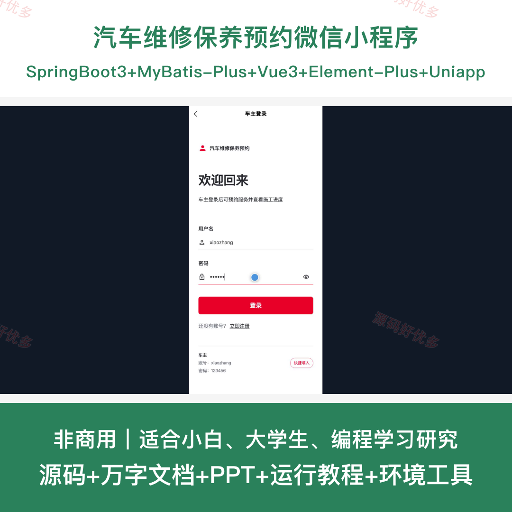
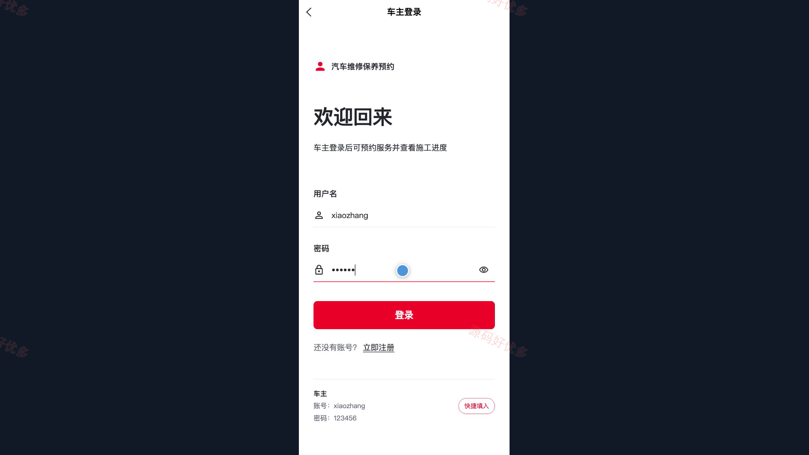
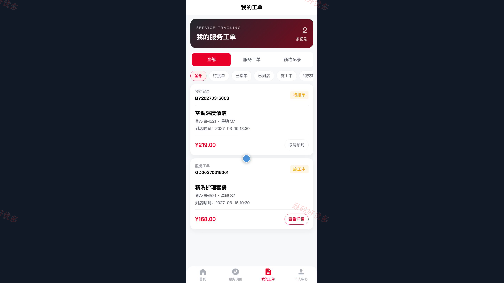
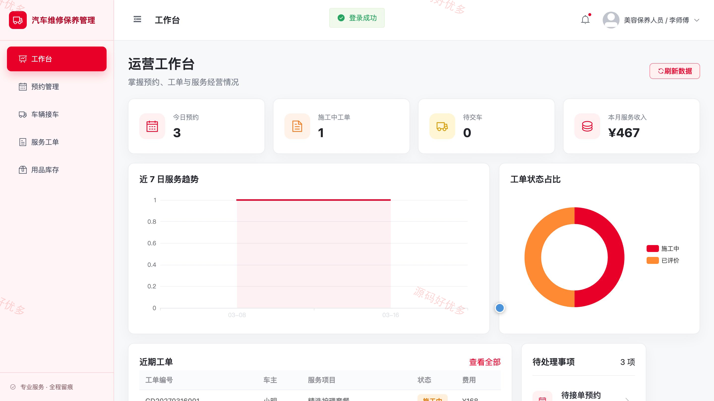
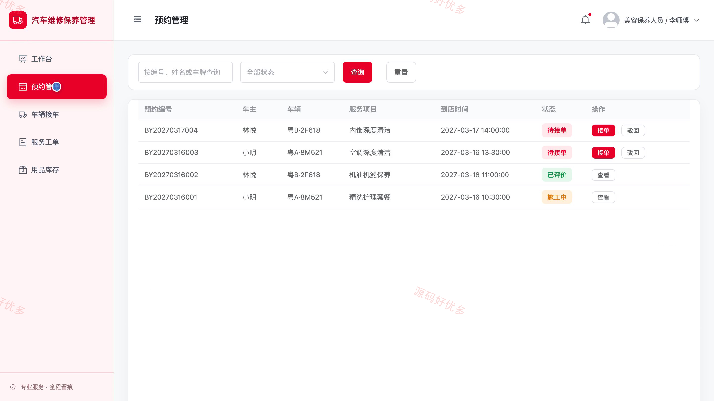
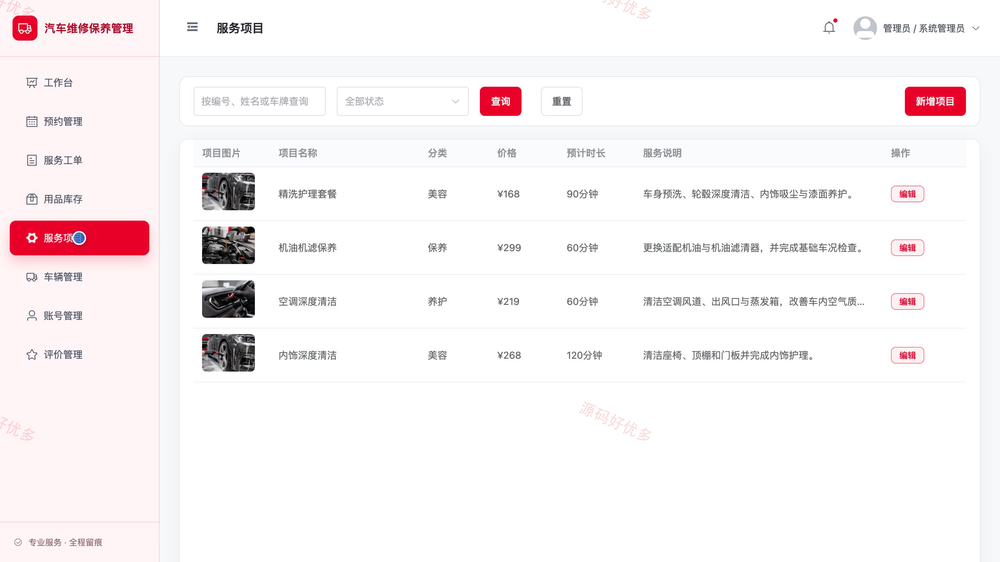

# bs025B
bs025B汽车维修保养预约小程序源码JavaSpringBoot3Vue3文档PPT
## 源码问题查看主页咨询

### 一、关键词
汽车维修、车辆保养、维修预约、服务工单、汽车美容

### 二、作品包含
源码+数据库+万字设计文档+PPT+全套环境和工具资源+本地部署教程

### 三、项目技术
前端技术： Html、Css、Js、Vue3.4、Element-Plus、uniapp
后端技术：Java、SpringBoot3.2.0、MyBatis-Plus

### 四、运行环境要求
开发工具：IDEA/eclipse + VSCODE + HBuilder X + 微信开发者工具

数据库：MySQL5.7+（共11张表）

数据库管理工具：Navicat10以上版本

环境配置软件： JDK17 + Maven3.6.3

前端Nodejs：20

浏览器：谷歌浏览器

### 五、项目介绍
项目编号：bs025B

汽车维修保养预约小程序面向车主、美容保养人员和管理员，覆盖服务项目浏览、车辆档案、在线预约及维修工单跟踪。工作人员负责接车、施工与用品领用，管理员统一维护服务项目、车辆、账号和评价数据。

角色：车主、美容保养人员、管理员

车主功能：小程序登录与注册、维修保养服务浏览、在线预约、车辆档案管理、服务工单与进度查询、工单评价、个人资料与密码维护。

美容保养人员功能：管理端登录与工作台、预约接单管理、车辆到店接车、服务工单处理、施工进度维护、维修用品库存与领用管理。

管理员功能：管理端登录与工作台、预约与服务工单管理、维修用品库存管理、服务项目管理、车辆与账号管理、服务评价管理。

### 六、运行截图

